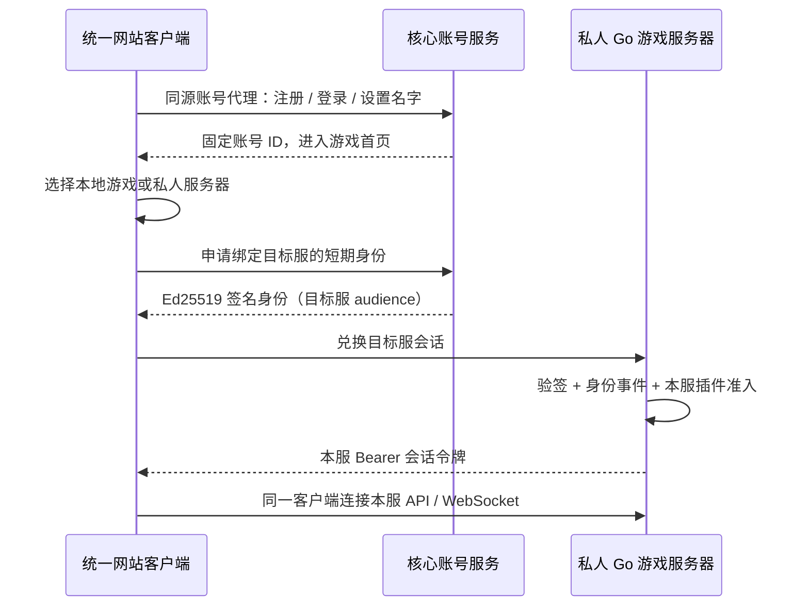

# 核心账号与独立游戏服务器

所有玩家访问统一游戏网站，网页就是客户端。未登录时先注册或登录核心账号，设置名字后进入游戏首页，选择浏览器本地游戏或加入私人服务器。核心账号服务 `mcraft-account` 负责注册、密码登录、固定玩家 ID、玩家名字与游戏服务器登记。`mcraft` 负责私人服世界、背包、权限与本服插件。玩家注册后获得随机的 32 位十六进制 ID；改名、加入另一台服务器、本服插件注册都不改变它。已有账号迁移保留原 ID，包括历史格式。



这是自托管的 `mcraft-account-v1` 身份协议。网站账号请求通过固定目标的 `/identity-api` 同源代理转发到核心；核心会话 Cookie 与密码不会转发给私人服。目标服会话只保存在当前浏览器的 `sessionStorage`，按服务器 ID 与目标 origin 隔离。旧授权码流程继续兼容，使用 [RFC 7636 的 PKCE S256](https://www.rfc-editor.org/rfc/rfc7636)，遵循 [RFC 9700](https://www.rfc-editor.org/rfc/rfc9700) 的精确回调地址校验与状态绑定原则。

## 本机运行

`npm start` 默认启动核心账号 `127.0.0.1:8082`、Go 游戏服 `127.0.0.1:8081` 和前端 `127.0.0.1:8080`。首次启动将现有 `data/accounts.json` 复制到 `data/account-core/accounts.json`，事先在源文件旁保存 `.pre-core-*.bak`。已有核心文件不会重复导入；账号 ID、密码哈希、玩家名字与会话保持原值。迁移前先保存并停止旧游戏进程。

本地迁移可启用 `IDENTITY_ALLOW_LEGACY_COOKIE=true`，让已有浏览器的合法旧会话登录核心。对外部署应设为 `false`。旧 `data/accounts.json` 保留作备份，中央模式的游戏服不会用其中的密码登录，也不会在核心不可用时退回本地账号。

复制根目录 `.env.example` 后可分别运行：

```sh
npm run start:account
npm run start:backend
npm run start:frontend
```

`ACCOUNT_MODE=local-core` 用于一键启动三个进程；`central` 仅启动游戏与前端并连接指定核心；`legacy` 保留旧独立账号模式以便兼容。直接运行二进制通过 `AUTH_ISSUER_URL` 是否设置决定身份模式，`ACCOUNT_MODE` 是 Node 启动器的设置。

## 部署核心账号服务

```sh
cd backend
go build -o bin/mcraft-account ./cmd/mcraft-account
IDENTITY_DATA_DIR=/srv/mcraft-account \
IDENTITY_PUBLIC_URL=https://login.ccraft.app \
IDENTITY_HOST=127.0.0.1 IDENTITY_PORT=8082 \
IDENTITY_ALLOW_LEGACY_COOKIE=false AUTH_COOKIE_SECURE=true \
./bin/mcraft-account
```

反向代理 `accounts.example.com` 到 `127.0.0.1:8082`，启用 HTTPS。只有回环地址允许 HTTP。核心的密码与会话不发送到游戏服或游戏插件。`IDENTITY_PLUGIN_DIR` 可以指定核心独立插件目录；默认 `account-plugins/`，不会加载游戏插件目录。

核心存储目录含 `accounts.json`（密码 bcrypt 哈希及核心会话）、`signing-key.json`（Ed25519 私钥）、`servers.json`（登记服务器）、`admins.json`（管理员固定 ID）、`admin-audit.jsonl`（管理操作审计）和插件数据。停止核心后备份**整个目录**；恢复时保留同一私钥与账号文件。游戏世界备份不包含核心账号目录，游戏服也不需要核心私钥。管理页面由核心服务内置提供，详见 [ACCOUNT_ADMIN.md](ACCOUNT_ADMIN.md)；`npm run package:account` 可以打包独立账号服务，不需要游戏引擎或前端 Node 服务。

核心后台路径 `/admin`，管理员通过 `IDENTITY_ADMIN_USERS` 引导配置并按固定 ID 持久保存，与任何游戏服的 OP 权限独立。首次管理字段写入会备份原始账号文件，再以兼容 API v1 的附加字段记录注册 IP、最近登录与禁用状态；旧数据无法追溯的 IP 保持未知。公网反向代理需要设置明确的 `IDENTITY_TRUSTED_PROXIES`，默认忽略客户端伪造的转发 IP 头。`IDENTITY_GAME_HOME_URL` 可配置账号中心的“进入游戏首页”入口。

## 玩家自行开服

1. 部署 Go 游戏服，确定本服的公开 HTTPS 地址和统一游戏客户端网站地址。
2. 用核心账号登录账号中心，登记服务器名称、统一网站首页和本服 Go 回调地址（必须以 `/api/auth/callback` 结束）。账号中心返回固定服务器 ID、公钥与配置。回调地址不可重复登记，游戏服不会从请求 Host 拼接回调地址。
3. 在该服务器环境配置返回值；独立 Go 二进制不会读取 `.env`，Node 启动器会读取。

```dotenv
ACCOUNT_MODE=central
AUTH_ISSUER_URL=https://login.ccraft.app
AUTH_SERVER_ID=登记获得的服务器ID
AUTH_PUBLIC_KEY=账号中心返回的Ed25519公钥
GAME_PUBLIC_URL=https://play.example.com
AUTH_CALLBACK_URL=https://private.example.com/api/auth/callback
ALLOWED_ORIGINS=https://play.example.com
AUTH_COOKIE_SECURE=true
```

服务器配置不同的 `DATA_DIR`、游戏端口和插件目录。`GAME_PUBLIC_URL` 与 `ALLOWED_ORIGINS` 指向统一客户端网站，`AUTH_CALLBACK_URL` 指向本服 Go 服务；服主无需再部署一套供玩家注册登录的游戏网页。`AUTH_PUBLIC_KEY` 建议固定为账号中心返回值；为空时从明确配置的核心元数据地址 `/.well-known/mcraft-identity` 发现公钥。生产服务器必须保持 HTTPS 核心地址和签名密钥一致；未知签名、错误服务器 audience、过期凭据均拒绝。客户端跨服请求使用本服 Bearer 会话；WebSocket 通过子协议携带该令牌，避免依赖第三方 Cookie。

统一网站的 Node 服务只将 `/identity-api` 转发到配置好的核心地址，不接受用户指定的账号代理目标。网站 `CLIENT_PUBLIC_URL` 固定公开 origin，`IDENTITY_PROXY_URL` 可指定与公开 issuer 不同的固定内网上游；核心请求的 Origin 仍保持 `IDENTITY_PUBLIC_URL`。Node/Nginx 部署和各层 IP 信任配置见 [CLIENT.md](CLIENT.md)。客户端访问私人 Go 游戏服 `GET /api/server` 获取公开的服务器 ID 和世界入口；核心登记的回调 origin 必须与目标服匹配。加入流程为：

1. 网站通过同源账号代理调用核心 `POST /api/auth/server-proof`，提交 `{ "serverId": "目标服ID" }`。核心要求已登录且设置玩家名字，返回一次性 60 秒签名凭据、目标服务器 ID、issuer 与登记的 `callbackApiOrigin`。
2. 客户端向目标 Go 游戏服 `POST /api/auth/client` 提交 `{ "proof": "短期签名凭据" }`。目标服校验 audience 与来源，再通过核心 `POST /api/token/client` 消耗该凭据，获取原有 10 分钟身份租约，并签发只属于本服的随机会话令牌。短期凭据不能重复使用，也不能转用于另一台游戏服。
3. 网站继续在同一客户端显示本服世界；REST 请求使用本服 `Authorization: Bearer ...`，WebSocket 使用约定的令牌子协议。令牌只保存在 `sessionStorage`，按目标 origin 和服务器 ID 隔离；登出清理本服会话。核心密码、Cookie 与原始核心会话数据库始终不交给私人服。

中央模式只在 `data/federation.json` 保存公开玩家资料和本服绑定的短期签名会话，**不保存核心密码哈希**。世界存档和运营权限继续按固定 ID 保存，各游戏服的背包与权限互相独立。游戏服每 30 秒向核心检查并刷新 10 分钟有效的身份租约，网络请求不占用游戏状态锁；核心登出后通常在下一次检查撤销本服会话并断开玩家。核心不可用时已签发租约只在原有效期内有效，过期后重新登录，不接受未经验证的身份。重启恢复也必须验签。

游戏服备份包含 `federation.json`；恢复中央模式备份时仍使用相同身份配置。`mcraftctl restore` 需要环境中设置上面的 `AUTH_*` 与 `GAME_PUBLIC_URL`。老格式备份不会重新激活本地密码登录。

核心后台只统计统一网站的已登录访客。客户端首页、本地游戏、线上游戏与账号/管理页面都通过 `POST /api/auth/heartbeat`（统一网站使用同源账号代理）发送 `{connectionId, online}`。连接 ID 为每个可见页面活动生命周期独立生成的 32 位小写十六进制随机值；约每 30 秒发送 `online=true`，隐藏或离开时发送 `false`，重新可见时换新 ID。账号按固定 ID 去重，活动页面数汇总；异常断网约 90 秒过期。后台 `location` 为 `website`，不显示所游玩的服务器。

游戏服不再发送或汇总玩家在线状态。旧 `POST /api/presence` 接口停止接收游戏服上报；服务器登记和 `/api/token/status` 身份租约检查不产生网站在线记录。核心重启后按新的网站活动收集在线状态，不把历史登录会话当成在线。原凭据、核心会话、密码与私人世界数据不会出现在管理响应或在线事件中。

## 插件扩展本服注册

登录核心只验证“是谁”，本服插件决定是否允许使用世界。插件接收到只读 `e.Identity.ID`，以及游戏事件的 `e.Player.AccountID`；旧 `e.Player.UID` 仍是原来派生的建造 UID，以兼容 API v1。

`player.authenticate.before` 的 `data.action` 为 `check`（核心回调）、`register` 或 `login`，原因分别为 `core_login`、`server_register`、`server_login`。插件可修改：

| 字段 | 规则 |
| --- | --- |
| `authenticated` | 布尔值；`check` 默认 true，本服提交默认 false |
| `prompt` | 最多 240 个字符 |
| `fields` | 最多 8 个 `{name,label,type}`，name 不重复，type 仅 text/password |

插件把 `authenticated` 改为 false 后，玩家仍已验证核心身份，但游戏与管理 API 拒绝准入；前端展示插件定义的字段及“本服注册 / 本服登录”。提交到 `POST /api/auth/server-access`，仅接收已声明字段；值最长 256 字符，整个请求最长 4KB。输入仅供这次前事件处理，不进入成功事件或账号存档。插件不得记录明文密码。

取消、字段类型非法或存档失败均不授予权限，不发成功事件。游戏或核心的准入插件失效时阻止对应操作；Monitor 的修改、取消和动作一律无效。固定 ID、用户名、issuer、操作者和目标不可修改。完成事件在存档成功后发送，插件应在完成事件持久化自己的本服注册状态，按固定 ID 查询，不能按可修改名字识别人。

`backend/examples/server-auth/` 演示本服邀请码注册，`npm run plugins:build` 编译到 `backend/bin/examples/server-auth/`，不会自动加载。需要时将整个构建目录复制到目标游戏服 `PLUGIN_DIR/server-auth/`，设置 manifest 的 `config.inviteCode` 并重启。游戏服默认插件仍不要求邀请码。

## 账号与准入事件

完整目录由两类服务的 `GET /api/events` 返回；事件只在所属服务产生。

| 服务 | 前事件 | 完成事件 | 可修改字段 |
| --- | --- | --- | --- |
| 核心 | `account.register.before` | `account.registered` | 无 |
| 核心 | `account.login.before` | `account.logged_in` | 无 |
| 核心 | `account.profile.before` | `account.profile.changed` | name |
| 核心 | `account.logout.before` | `account.logged_out` | 无 |
| 核心 | `account.server_register.before` | `account.server_registered` | name |
| 核心 | `account.server_authorize.before` | `account.server_authorized` | 无 |
| 核心 | — | `account.server_authorization.consumed` | 无 |
| 核心 | `account.admin.status.before` | `account.admin.status.changed` | 无 |
| 核心 | `account.admin.sessions_revoke.before` | `account.admin.sessions_revoked` | 无 |
| 游戏 | `player.identity.before` | `player.identified` | 无 |
| 游戏 | `player.authenticate.before` | `player.authenticated` / `player.authentication.required` | authenticated, prompt, fields |
| 游戏 | `player.logout.before` | `player.logged_out` | 无 |

`player.identity.updated` 表示核心改名同步成功（`core_profile`）；`player.identity.expired` 表示身份撤销或到期提交成功（`core_revoked` / `core_expired`）。核心撤销属于外部事实，这两个通知不可取消。事件均有只读身份快照；核心密码、Cookie、授权码和签名凭据不进入事件。核心插件支持事件取消和已声明字段修改，游戏动作与世界命令仍由游戏服执行。

网站加入私服的三个核心事件均提供固定 `actor=账号ID`、`target/serverId=目标服ID` 和 `reason=client_server_join`。`account.server_authorize.before` 可取消、无可修改字段；仅在短期凭据成功登记后发出 `account.server_authorized`，凭据成功一次性兑换后才发出 `account.server_authorization.consumed`。事件不包含签名凭据、核心会话或本服令牌。游戏服准入仍经过原 `player.identity.before` 与 `player.authenticate.before` 路径，取消或校验失败不能授予本服权限。

`account.presence.updated` 与 `account.presence.offline` 是只读的网站活动事实通知；状态变更与通知按顺序提交，不能取消。`location=website`，兼容 `serverId` 字段为空，连接标识只代表网站页面活动。上线原因为 `website_heartbeat`，主动离开为 `website_leave`，无活动过期为 `heartbeat_expired`；账号退出、管理禁用或撤销仍使用对应会话失效原因。后台管理 before 可取消，但操作者、目标和状态值不可修改；取消、校验或保存失败不发成功事件。管理事件携带稳定原因标识和前后账号快照，审计记录操作结果，两者均不含凭据。可选 `account-policy` 示例由 `npm run plugins:build` 编译到 `backend/bin/examples/account-policy/`，由运营者选择安装到核心专属插件目录，默认不会自动启用。

验证：`npm run accounts:verify` 覆盖双游戏服同一 ID、改名/撤销传播、PKCE/state/重放/签名/audience、旧账号备份迁移、插件取消/非法字段/Monitor、存档失败回滚与签名会话恢复；`npm run backend:test` 运行完整 Go 竞态回归（包含后台权限、注册 IP、在线续期、撤销及存档兼容），`npm run plugins:smoke` 验证现有游戏插件；`npm run account:package:smoke` 验证提取后的独立账号发布包。
